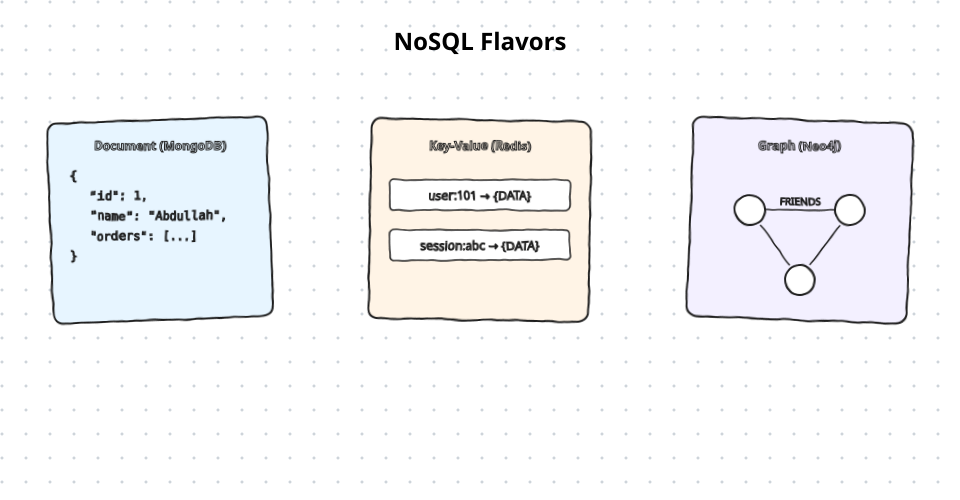
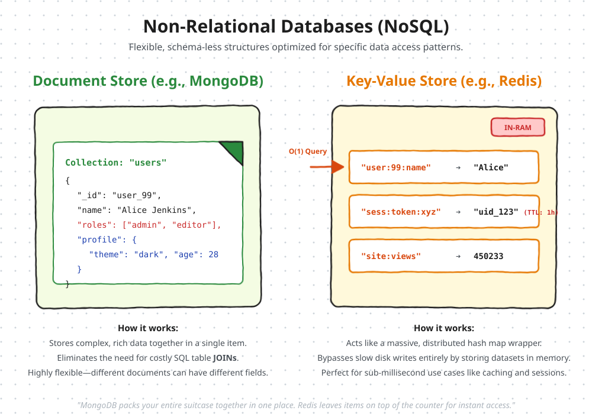
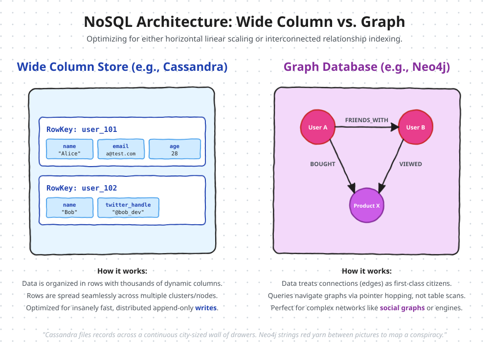

# Databases SQL NoSQL Graph

When choosing database, the two main options are relational (SQL) and Non - Relational (NoSQL) databases.

## Relational Databases (SQL) 
Structure: Data is organized into tables, rows, and columns, similar to spreadsheets.
Examples: PostgreSQL, MySQL, Oracle, and SQLite.
Key Advantages:
- Joins: Enables complex operations to link data across multiple tables (e.g., linking customers to orders).
- ACID Compliance: Ensures data integrity through Atomicity, Consistency, Isolation, and Durability, making them ideal for financial or transactional systems.
## Non-Relational Databases (NoSQL) 
Overview: Designed for flexibility and fast access to large volumes of unstructured or semi-structured data.
Types:
- Document Stores: (e.g., MongoDB) Uses JSON-like documents for complex, nested data.

- Key-Value Stores: (e.g., Redis, Memcached) Extremely fast, storing data in RAM as simple key-value pairs.
Choosing the Right Database

- Wide Column Stores: (e.g., Cassandra, Cosmos DB) Optimized for massive scale and write-heavy operations.

- Graph Databases: (e.g., Neo4j) Focuses on relationships between entities (e.g., Amazon’s product recommendations).
- Use SQL if: Your data is well-structured, relationships are critical, or you require strong transactional consistency (e.g., e-commerce, banking).
- Use NoSQL if: Your application demands super low latency, requires horizontal scalability, or handles unstructured/highly dynamic datasets where rigid schemas are a hindrance.

---

