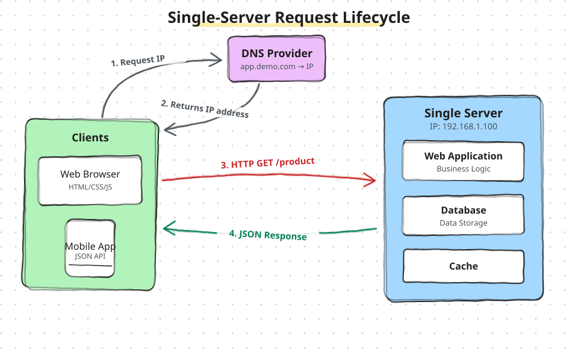
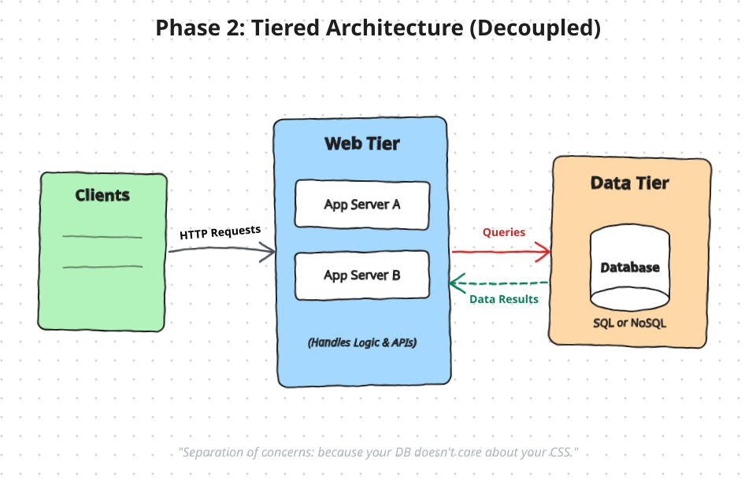

# Single Server Setup

## Requesting the Address
- Your Device (A Web Browser or Mobile App) Wants to talk to `app.demo.com`. Computer don't understand names; they only understand numbers called IP Addresses (like 192.168.1.100).
- Your device reaches out to a DNS Provider (Domain Name System), Which acts like the internet phonebook, and asks "Hey, What is the actual number for `app.demo.com`.

## Getting the Address Back
- The DNS Provider looks up the name, find the matching number, and returns the IP address back to your device.
- Now, Your browser or app knows exactly where to go on the internet to find the Server

## Making the Request
- Armed with the correct address, your device sends a direct message over the internet to the Single Server.

## Delivering the data
- Once the server gathers all the information, it packages it up and sends a JSON Respons back to your device.]
- JSON is just a clean, Organized text format the computer love. Your web browser or  mobile app takes this raw data, turns it into a pretty layout with colors and buttons, and displays it on your screen .

This diagram shows a Tiered Architecture, which splits an application into three separate zones 
- Clients who request info
- A Web Tier (App Servers A & B)
- Data Tier

Now they can scale and independently and keep user data secure

---

