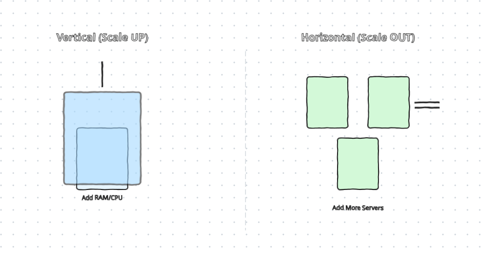

# Vertical vs Horizontal Scaling
As user demand Grows, a single server struggles under heavy traffic, creating the need to scale the system infrastructure.

## Vertical Scaling (Scale-Up)
Adding More hardware resources (RAM, CPU, Storage) to the existing server.

- Advantage: Simple to implement, works well for low or moderted traffic.
- Limitations:  Has a hard resource limit cap(you cannot upgrade indefinitely) lacks redundancy, creating a Single Point of Failure (SPOF) where the entire applcation goes down if the server fails.

## Horizontal Scaling (Scale-Out)
Adding more individual servers to share incoming traffic load instead of relying on a single machine.

- Advantages: Offers superior scalability (Servers can be infinitely as needed) and higher fault tolerance of relying on a single machine.

---

